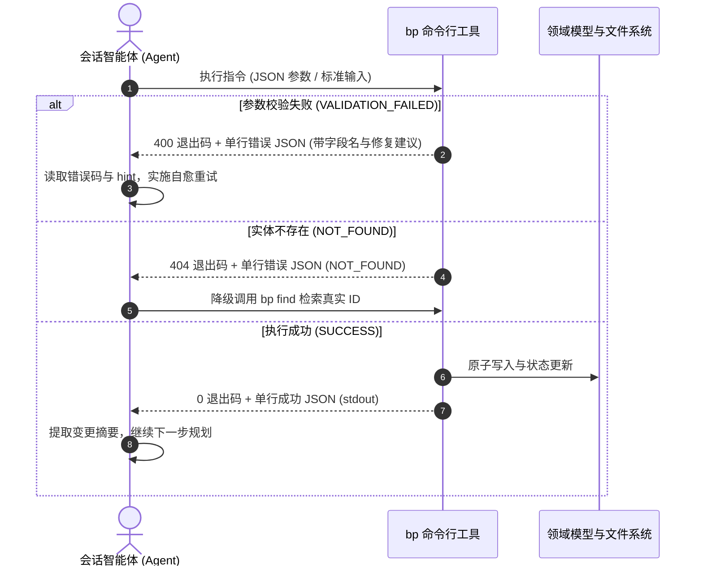

# 命令行工具与协议契约规范

命令行工具（`bp`）是宿主会话中 AI 智能体（Agent）操纵画布模型的**唯一机器接口（CLI-as-RPC）**。

在 LLM 驱动的自动化协作体系中，命令行不仅仅是一个终端工具，更是程序间通信的正式通信协议。**输出格式的绝对稳定性与确定性，其优先级远高于命令功能的丰富度**。

---

## 交互与自愈协议架构



---

## 一、 标准 I/O 输出契约

为确保大语言模型能够实现 100% 确定性的结构化解析，CLI 的输出必须严格遵守以下二进制级机器规范：

### 1. 成功输出（Standard Output）
- **格式要求**：标准输出（stdout）有且仅输出**单行合法 JSON 字符串**。
- **结构规范**：以 `{"ok": true, ...}` 开头，携带本次操作的核心变更载荷或查询结果摘要。
- **示例**：
  ```json
  {"ok":true,"action":"insert","nodeId":"layer_rect_982","parentId":"screen_home"}
  ```

### 2. 失败输出（Standard Error）
- **格式要求**：标准错误（stderr）输出**单行结构化错误 JSON**，同时进程必须以**非零退出码（Non-zero Exit Code）**终止。
- **结构规范**：必须包含机器可判别的错误枚举、人类可读的简明错误描述，以及面向模型的修复指引。
  ```json
  {"ok":false,"code":"VALIDATION_FAILED","message":"宽度值不能小于 0","field":"width","hint":"请输入大于等于 0 的数字"}
  ```

### 3. 严格禁止终端字符污染
- **绝对禁止 ANSI 转义序列**：严禁携带终端颜色高亮码（如 `\u001b[31m` 等），避免污染模型的上下文语义。
- **绝对禁止 TTY 动态刷新字符**：严禁输出动态进度条、旋转指示器（Spinners）或多行非结构化说明文字。模型消费的是机器字节流，非结构化文本会直接破坏 JSON 解析器。

---

## 二、 机器友好的错误分类与自愈协议

错误码的核心设计目标是**为智能体的条件分支判断与自动化修复（Self-Correction）提供明确语义**，而非供人类肉眼阅读。

模型在处理命令失败时，**必须基于 `code` 字段进行逻辑分支，严禁基于 `message` 的自然语言文本做模糊正则匹配**：

| 错误码枚举 (`code`) | 核心语义说明 | 智能体推荐的自愈行为（Self-healing Action） |
|---|---|---|
| `USAGE` | 命令行参数缺失或语法格式错误 | 读取返回的用法提示，修正参数命名或类型后重试。 |
| `NOT_FOUND` | 指定的屏幕 ID、图层 ID 或目标文件不存在 | 停止盲目重试，先调用 `bp find` 或 `bp screen list` 重新查询获取真实有效的目标 ID。 |
| `VALIDATION_FAILED` | 属性取值违反了领域模型约束（如超限） | 定位响应载荷中的 `field` 字段，仅针对性微调该非法属性值，其余上下文保持不变。 |
| `CONFLICT` | 目标节点已被占用或引用存在循环依赖 | 重新读取当前树结构，调整层级归属关系。 |
| `INTERNAL` | 系统底层发生未捕获异常或断言失败 | 判定为工具实现缺陷，立即终止当前任务链并向用户如实报错，禁止无限循环重试。 |

---

## 三、 单一真相来源的校验体系（Single Source of Truth）

属性与样式的合法性约束（例如：宽度下限、圆角范围、字号阶梯），必须收敛在**单一元数据字段定义表**中。

```
              ┌─────────────────────────────────────┐
              │   单一元数据字段定义 (Field Meta)   │
              └──────────────────┬──────────────────┘
         ┌───────────────────────┼───────────────────────┐
         ▼                       ▼                       ▼
┌──────────────────┐    ┌──────────────────┐    ┌──────────────────┐
│ CLI 运行时校验器 │    │ JSON Schema 导出 │    │ 静态技能指引文档 │
│ (Runtime Engine) │    │ (Tool Schemas)   │    │ (Skill Docs)     │
└──────────────────┘    └──────────────────┘    └──────────────────┘
```

- **杜绝校验逻辑漂移（Spec Drift）**：严禁在 CLI 校验器、Schema 导出工具与静态技能文档中分别硬编码三份校验规则。多份定义必然随时间推移发生脱节，导致模型根据 Schema 生成了参数，却被运行时的 CLI 校验器拒收。
- **差异化的校验边界策略**：
  - **交互容错策略（面向人类画布拖拽）**：采用**区间夹取（Clamp）**。用户在界面上若把矩形拖出负数宽度，排版引擎自动平滑纠正为 0，保障操作不中断。
  - **契约严格策略（面向 AI 命令行调用）**：采用**即时报错阻断**。非法数值直接抛出 `VALIDATION_FAILED` 并返回字段边界提示，促使模型通过显式学习单次纠偏。

---

## 四、 参数流水线的归一化与前置合并

在判断“本次操作是否为空指令”时，必须保证所有来源的输入参数已全量完成流水线归一化合并，杜绝过早断言。

```ts
// ❌ 错误做法：在参数管道合并完成前过早拦截，导致合法参数被误判为「空操作」
const patch = buildBasePatch(args);
if (Object.keys(patch).length === 0) {
  throw new ProtocolError('USAGE', '未提供任何需要更新的属性参数');
}
if (args.icon) {
  patch.iconSet = resolveIconSet(args.icon);
}

// ✅ 正确做法：完成全渠道参数归一化合并后，再执行非空校验
const patch = buildBasePatch(args);
if (args.icon) {
  patch.iconSet = resolveIconSet(args.icon);
}
if (Object.keys(patch).length === 0) {
  throw new ProtocolError('USAGE', '未提供任何需要更新的属性参数');
}
```

---

## 五、 大文档的按需分段读取策略（Selective Slicing）

随着项目复杂度增长，单份蓝图可能容纳数十个屏幕与数千个节点，整份 JSON 吞吐会严重挤占大模型的上下文窗口（Context Window）。

CLI 必须提供细粒度的查询子命令，支持智能体按需索取切片：

```bash
bp screen list                       # 仅返回屏幕 ID 与名称摘要，不加载具体图层
bp screen get --id=<屏幕ID>          # 仅获取指定屏幕的完整图层子树
bp layer get --id=<图层ID>           # 仅提取单个图层节点的元数据与样式
bp layer get --id=<图层ID> --depth=1 # 仅提取图层自身及其一级直接子节点
bp find --name=<语义名称>            # 通过模糊名称定位目标 ID，获取精准寻址锚点
```

### 分段检索核心原则
1. **范围最小化**：读取单个图层属性时，严禁附带其庞大的兄弟节点；读取单屏时，不携带其他未激活的屏幕。
2. **两阶段检索（ID-first 模式）**：先通过轻量列表或查询命令获取目标 `id`，再基于 `id` 精准调取局部节点。这是保障大模型上下文成本可控的标准工业范式。
3. **列表返回摘要（Summary），不返回详情（Detail）**：列表命令仅供检索索引，详细结构由调用方二次精准查询。

---

## 六、 技能（Skills）的静态文本定位与质量要求

- **技能是无状态的静态指导文件**：技能文档仅声明“在何种业务场景下、调用哪个 CLI 命令、期望的交付物标准是什么”。插件服务端代码严禁在运行时动态拼装提示词或代模型发起请求。
- **示例命令必须 100% 可复现**：技能文档中出现的所有 CLI 命令示例，必须能够直接在命令行中无错误执行。任何 CLI 参数或子命令的变更，均须同步更新技能文档中的代码样例。

---

## 七、 协议变更验证门禁

凡涉及 CLI 契约定义、输出字段或校验逻辑的修改，提交前必须完整执行以下自动化套件：

```bash
# 1. 运行底层协议与格式契约自动化测试
pnpm -C apps/plugin test

# 2. 在真实沙箱工作区中运行端到端验收脚本
node apps/plugin/scripts/acceptance.mjs
```

前者在内存级断言输入输出 JSON 格式契约的完备性，后者模拟外部智能体在真实文件系统上走通全流程操作。
