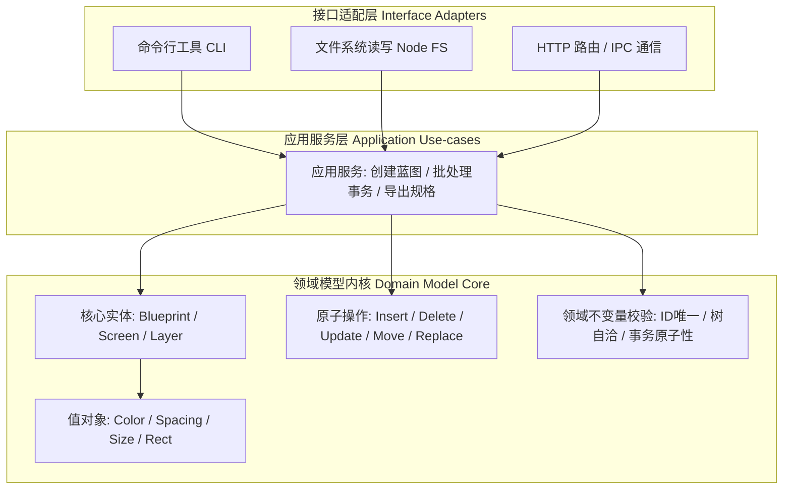

# 数据层架构与领域模型规范

数据层是蓝图（Blueprint）系统的**核心数字资产与状态真理来源**。

它的核心职责是精确描述「一个蓝图由什么构成、遵循何种业务规则与状态转移逻辑」。它对数据在磁盘上如何持久化、通过何种协议在网络中传输、以及在浏览器界面上如何渲染，保持**绝对的无知与零依赖**。

---

## 依赖架构：整洁架构与单向依赖

数据层严格遵循整洁架构（Clean Architecture）原则，系统的依赖方向只能**自外向内单向依赖**，内核绝对禁止感知外层细节：



### 依赖隔离黄金法则
- **领域内核的纯粹性**：领域模型目录（Domain Model）内严禁出现对 Node.js 原生模块（`fs`、`path` 等）、外部第三方库或前端渲染层（`react` 等）的引用。
- **检验标准**：将领域核心代码单独拷贝到一个没有任何外部依赖的空白 TypeScript 工程中，必须能够瞬间完成类型检查与纯内存单元测试编译。

---

## 一、 领域模型核心要素

领域层内部严格区分以下四类概念，杜绝职责混淆：

### 1. 实体（Entities）
- **定义**：拥有稳定生命周期和全局唯一身份标识（ID）的对象。
- **代表**：`BlueprintDocument`（蓝图工程）、`Screen`（屏幕）、`Layer`（图层）。
- **特质**：即使两个屏幕的宽高、背景色、内部所有子图层完全相同，只要它们的 `id` 不同，它们就是两个完全独立的世界；反之，哪怕一个图层的所有样式属性被彻底重写，只要它的 `id` 保持不变，它依然是同一个实体。

### 2. 值对象（Value Objects）
- **定义**：没有独立身份标识、其语义完全由内部属性值决定的不可变（Immutable）数据结构。
- **代表**：`Color`（填充与边框颜色）、`Dimensions`（尺寸）、`Padding`（内边距）、`CornerRadius`（圆角值）。
- **特质**：值对象的比对必须基于**内容值等价性（Value Equality）**，严禁基于 JavaScript 内存引用（`===`）比对。两个 RGB 数值相同的颜色对象在业务上是完全等价的。

### 3. 封闭式领域操作集（Domain Operations）
改变实体状态的途径不是肆意调用 setter，而是通过严格受控的**五种原子状态转移指令**（不多不少，构成完备的状态代数）：
- `insert`：在指定父容器的特定层级索引处插入新节点（必须携带自包含子树）。
- `delete`：安全移除指定节点及其从属关系。
- `update`：对指定节点的局部样式或布局属性应用增量补丁（Patch）。
- `move`：在同一容器内调整图层前后层级，或跨容器跨屏幕重新挂载父子归属。
- `replace`：在保留既有稳定身份的前提下，用全新规范结构原子替换旧节点。

### 4. 领域不变量（Domain Invariants）
在任何一次操作执行前、执行中与执行后，系统必须**无条件成立的硬性约束**：
- **ID 全局唯一性**：整个文档树内严禁存在重复的节点 ID。
- **树结构无环性**：容器图层绝对禁止将自身或祖先节点挂载为自己的子节点。
- **事务原子性（All-or-Nothing）**：多条原子操作组成的批处理事务，只要有一条校验失败，整个批次必须完全回滚，严禁留下半生不熟的中间脏状态。

---

## 二、 关键设计约束与反模式防护

### 1. 严格禁止反向依赖污染

```ts
// ❌ 严重违规：领域模型内核直接 import 了外层文件系统，内核纯度被打破
import { readDocumentFromFile } from '../adapters/node/docfile';

export function mutateScreen(doc: BlueprintDocument) {
  // 依赖了特定环境的 I/O 实现
}

// ✅ 正确范式：领域模型仅依赖纯净的类型契约，保持纯函数特性
export function applyOps(
  doc: BlueprintDocument, 
  ops: readonly DocumentOp[]
): Result<BlueprintDocument, DomainError> {
  // 纯内存状态计算，无任何副作用
}
```

---

### 2. 使用判别联合类型（Discriminated Unions）消除万能对象

```ts
// ❌ 反模式：上帝对象（God Object）模式，所有可能字段扁平平铺，导致逻辑全靠猜
interface Layer {
  kind: 'text' | 'icon' | 'rect' | 'ellipse';
  fontSize?: number;       // 仅在 text 下合法，其他类型全是无效噪音
  iconSet?: string;        // 仅在 icon 下合法
  cornerRadius?: number;   // 仅在 shape 下合法
}

// ✅ 正确范式：通过 kind 字段严格区分变体，各类型属性自洽收窄
export type Layer = TextLayer | IconLayer | ShapeLayer | ContainerLayer;

export interface TextLayer {
  readonly id: string;
  readonly kind: 'text';
  readonly content: string;
  readonly fontSize: number;
  readonly lineHeight: number;
}

export interface IconLayer {
  readonly id: string;
  readonly kind: 'icon';
  readonly iconSet: string;
  readonly iconName: string;
  readonly size: number;
}
```
**设计收益**：
1. **编译期穷尽检查（Exhaustiveness Checking）**：TypeScript 能够在 `switch(layer.kind)` 中提供精准的代码补齐与漏项拦截。
2. **零无效字段**：开发者阅读类型即了解全部合法属性，杜绝“为文本图层错误赋值图标名称”的隐蔽缺陷。

---

### 3. 值对象深度等价比对，消除假性变更补丁

```ts
// ❌ 错误做法：直接使用 JavaScript 引用比对，导致内容完全一致的对象被判定为变更
if (currentLayer.fill !== nextLayer.fill) {
  patch.fill = nextLayer.fill; // 产生了不必要的脏标记与冗余补丁
}

// ✅ 正确做法：基于值语义执行深度内容相等性断言
if (!isEqualColor(currentLayer.fill, nextLayer.fill)) {
  patch.fill = nextLayer.fill;
}
```

---

### 4. 批处理操作的事务原子性保障（All-or-Nothing）

```ts
// ❌ 错误做法：边迭代边就地应用，中途抛错导致文档处于脏数据状态
export function applyBatch(doc: BlueprintDocument, ops: DocumentOp[]): BlueprintDocument {
  let current = doc;
  for (const op of ops) {
    current = applyOne(current, op); // 若第 5 条操作报错，前 4 条已不可逆地污染了状态
  }
  return current;
}

// ✅ 正确范式：两阶段提交（校验预检 -> 原子提交）
export function applyBatch(
  doc: BlueprintDocument, 
  ops: readonly DocumentOp[]
): Result<BlueprintDocument, DomainError> {
  // 阶段 1：全局校验预检与不变量断言
  for (const op of ops) {
    const check = validateOp(doc, op);
    if (check.isErr()) {
      return Result.err(check.error); // 立即熔断，原文档保持完全不可变
    }
  }

  // 阶段 2：校验全部通过，执行纯函数状态推进
  const updatedDoc = ops.reduce((acc, op) => executeOp(acc, op), doc);
  return Result.ok(updatedDoc);
}
```

---

## 三、 补丁完整性与代数往返律（Algebraic Round-trip Law）

数据层最核心的质量基石是**操作补丁的完全可逆性与自包含性**：

### 1. 容器子树自包含保全原则（Subtree Preservation）
当操作向文档中插入一个容器（Container/Frame）时，操作载荷必须**完整嵌套携带其全部子节点图层树**，绝对禁止为了精简体积而裁剪丢弃子元素。

```ts
// ❌ 严重灾难：剥除子元素导致容器被插入后退化为空壳，子图层永久丢失
ops.push({
  op: 'insert',
  parentId: 'screen_1',
  node: stripChildren(containerNode) // 违背自包含原则
});

// ✅ 正确范式：自包含携带整棵深层子树
ops.push({
  op: 'insert',
  parentId: 'screen_1',
  node: containerNode // 完整包含 children 数组及其递归子项
});
```

### 2. 状态代数往返测试契约
对于任意合法的蓝图状态 `DocA` 与 `DocB`，系统必须严格满足代数往返恒等式：

$$\text{applyOps}(\text{DocA}, \text{diff}(\text{DocA}, \text{DocB})) \equiv \text{DocB}$$

任何新增的图层种类或属性字段，必须在单元测试中通过此类差分-回放闭环测试套件的验证。

---

## 四、 本层变更验证门禁

任何对数据模型、领域校验规则或操作补丁逻辑的修改，提交前必须执行：

```bash
# 1. 严格模式静态类型检查（必须 0 错误）
pnpm -C apps/plugin typecheck

# 2. 领域模型单元测试套件（纯内存断言，高速通过）
pnpm -C apps/plugin test
```
