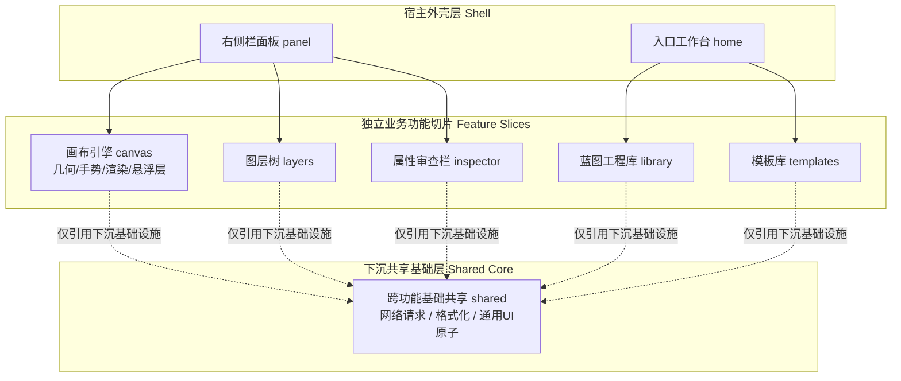

# 界面层架构与前端设计规范

界面层是蓝图系统面向人类设计工程师与宿主界面的可视化交互枢纽。

本层基于 **React 18 与 Zustand** 构建，核心设计目标是在极高频的画布交互（拖拽、缩放、对齐）下维持 60 FPS 甚至 120 FPS 的流畅帧率，同时保持代码库的高内聚、低耦合与严格的类型安全性。

---

## 模块组织：按功能垂直切分（Feature-First Architecture）

前端代码严格采用**按业务功能垂直切片**的组织模式，坚决禁止按技术类型（如把所有 hooks、components、stores 混杂平铺）进行横向分层。



### 垂直切分设计哲学
- **高内聚自治**：修改“画布拖拽手势”相关的逻辑，所有相关的组件、几何算法 Hook、手势状态与本地 Store 均集中在 `src/client/canvas/` 目录下，开发者无需在五六个深度嵌套的技术目录之间反复定位。
- **共享下沉严格受控**：业务模块内部的私有代码严禁随意向外暴露。只有当某个工具函数或基础组件被**两个及以上**的独立业务切片实际引用时，才允许下沉到 `src/client/shared/` 中。

---

## 一、 状态管理：全局统一收敛至 Zustand

全仓严格统一采用 Zustand 作为唯一的状态管理解决方案，严禁混用 React Context、Redux 或全局可变模块变量，彻底消除开发者的认知切换成本。

### 1. 标准 Store 建模范式（Action-Driven）
状态更新必须收敛在 Store 内部显式声明的动作方法（Actions）中，禁止外部组件直接随意调用 `set()` 篡改状态：

```ts
interface LibraryStore {
  readonly entries: readonly BlueprintEntry[];
  readonly isLoading: boolean;
  
  // 变更状态的唯一入口：语义化 Action
  reload(scope: Scope): Promise<void>;
  rename(id: string, nextTitle: string): Promise<void>;
}

export const useLibraryStore = create<LibraryStore>((set, get) => ({
  entries: [],
  isLoading: false,

  async reload(scope) {
    set({ isLoading: true });
    try {
      const reply = await requestJson<ListReply>(buildListUrl(scope));
      set({ entries: reply.data?.blueprints ?? [], isLoading: false });
    } catch (error) {
      set({ isLoading: false });
      throw error;
    }
  },

  async rename(id, nextTitle) {
    await requestJson(buildRenameUrl(), {
      method: 'POST',
      body: { action: 'rename', blueprintId: id, title: nextTitle },
    });
    // 状态流自闭环
    await get().reload(get().currentScope);
  },
}));
```

---

### 2. 细粒度选择器与防重渲染约束

订阅 Store 时，必须通过精准的选择器（Selector）**只订阅组件自身渲染必需的最小属性集**，严禁直接订阅整个 Store 对象：

```ts
// ❌ 严重反模式：订阅整个 store，任何无关字段发生微小变化，都会导致当前组件重渲染
const store = useLibraryStore();

// ❌ 隐蔽陷阱：在选择器内部每次字面量返回新对象，Zustand 判定引用变化，引发永久重渲染
const { entries, isLoading } = useLibraryStore((s) => ({
  entries: s.entries,
  isLoading: s.isLoading,
}));

// ✅ 正确范式 1：拆分原子粒度订阅
const entries = useLibraryStore((s) => s.entries);
const isLoading = useLibraryStore((s) => s.isLoading);

// ✅ 正确范式 2：需要合并订阅时，必须使用 useShallow 进行浅层比较阻断
import { useShallow } from 'zustand/react/shallow';

const { entries, isLoading } = useLibraryStore(
  useShallow((s) => ({ entries: s.entries, isLoading: s.isLoading }))
);
```

---

### 3. 派生数据保持即时计算，拒绝状态双写

凡是能够从已有状态中通过纯函数推导出的计算属性，**坚决不在 Store 中额外持久化一份拷贝**，彻底消除“双向同步漂移（Sync Drift）”隐患：

```ts
// ❌ 错误做法：同时维护源数据和派生列表，极易在异步更新时发生状态脱节
interface BrokenStore {
  layers: Layer[];
  selectedLayers: Layer[]; // 冗余派生字段
}

// ✅ 正确范式：Store 内仅存储纯净的选中 ID 索引，读取时在组件层利用 useMemo 派生
const selectedLayers = useBlueprintStore(
  useShallow((state) => {
    const idSet = new Set(state.selectedLayerIds);
    return state.document.layers.filter((layer) => idSet.has(layer.id));
  })
);
```

---

### 4. 状态放置原则：按消费半径划分（Colocation）
状态放置在哪里的唯一判断基准是**「谁消费它」**，而非数据类型的形式：
- **功能私有状态（局部 Store）**：例如画布当前的视口缩放比例（Scale）与平移偏移量（Pan），仅画布自身消费，严格存放在 `canvasStore` 中。
- **全局协同状态（公共 Store）**：例如当前活动的蓝图文档模型，人机对话、图层树、属性栏与导出服务均需读取，存放在根级 `blueprintStore` 中。

---

## 二、 交互性能保障：高频操作与帧率预算（Frame Budget）

画布级应用对交互流畅度要求极高，必须遵守以下前端性能铁律：

### 1. 瞬态交互（Transient State）与提交态（Committed State）分离
用户在画布上进行高频鼠标拖拽时，每秒触发百余次指针事件。若在 `pointermove` 过程中频繁调用 Store 的 `set()` 触发全量状态更新，会导致严峻的掉帧甚至卡死。

- **拖拽过程（高频瞬态）**：直接通过 DOM Transform、Canvas 临时图层或 React `useRef` 缓存坐标变动，绕过 React 调度机制以原生速度渲染。
- **释放鼠标（最终提交态）**：在 `pointerup` / `dragend` 事件发生时，将最终的几何位移一次性打包为原子操作补丁，Commit 写入 Store。

---

### 2. 引用稳定性与精准记忆化（Memoization）

```tsx
// ❌ 错误做法：在父组件渲染期每次生成新的对象和回调内联函数，导致子组件全量重绘
function CanvasContainer() {
  return (
    <CanvasViewport 
      handlers={{ onMove: (pos) => moveLayer(pos), onResize: (s) => resize(s) }} 
    />
  );
}

// ✅ 正确范式：使用 useCallback 与 useMemo 锁定稳定函数与对象引用
function CanvasContainer() {
  const handlers = useMemo(
    () => ({ onMove: handleLayerMove, onResize: handleLayerResize }),
    [handleLayerMove, handleLayerResize]
  );

  return <CanvasViewport handlers={handlers} />;
}
```

- **组件级防护**：复杂子组件（如属性输入组件、画布节点视图）必须使用 `React.memo` 包裹，切断无谓的向下级联更新。
- **大型长列表优化**：图层树节点（Layer Tree Rows）与图标网格（Icon Grid）必须对行组件实施 `React.memo` 隔离，确保选中某一行时，其余上百行不会发生级联重渲染。

---

## 三、 副作用治理：副作用仅用于外部系统同步

React 18 倡导纯渲染范式。`useEffect` 的职责是**与外部系统进行同步**（如绑定 DOM 原生事件、网络 I/O、尺寸监听等），**严禁将 `useEffect` 作为衍生状态计算的管道**。

```tsx
// ❌ 严重反模式：使用 useEffect 监听 A 状态来变更 B 状态，额外产生一轮昂贵的无谓重渲染
useEffect(() => {
  setFilteredItems(items.filter((item) => item.categoryId === activeId));
}, [items, activeId]);

// ✅ 正确范式：直接在渲染主流程中通过 useMemo 纯函数即时推导
const filteredItems = useMemo(
  () => items.filter((item) => item.categoryId === activeId),
  [items, activeId]
);
```

---

## 四、 自动化测试契约与可测试性设计

为了保证端到端测试（Playwright / E2E）不受 UI 样式变迁与多语言切换的干扰，界面交互元素必须遵守显式测试契约：

- **禁止依赖非稳定选择器**：严禁在测试中通过页面展示文案（如 `button:has-text("保存")`）或易变 CSS 类名（如 `.save-btn-primary`）定位元素。
- **统一测试标识符契约**：所有可点击、可输入、可拖动的核心交互节点，必须显式附加 `data-testid` 属性。
- **命名规范**：遵循 `<业务模块>-<组件元素>-<动作/角色>` 标准，全小写，连字符隔开：
  ```tsx
  <button data-testid="blueprint-create-btn">新建蓝图</button>
  <input data-testid="inspector-width-input" />
  <div data-testid="layer-tree-row-header" />
  ```

---

## 五、 本层变更验证门禁

任何对界面层组件、状态 Store 或样式布局的修改，在提交前必须依次通过三道自动化门禁：

```bash
# 1. 严格模式静态类型检查（0 错误通过）
pnpm -C apps/plugin typecheck

# 2. 前端单元测试与组件交互测试
pnpm -C apps/plugin test

# 3. 国际化文案一致性强制检查
pnpm -C apps/plugin i18n:check
```

特别说明：`i18n:check` 会静态扫描所有在界面中引用的文案键名，强制验证 `src/client/i18n/zh.json` 与 `en.json` 的键名集合与插值参数必须保持 100% 同步对齐。
