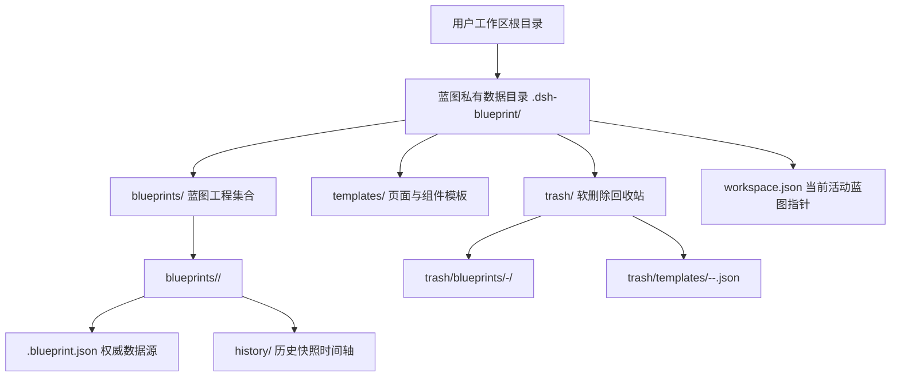
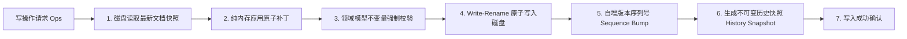
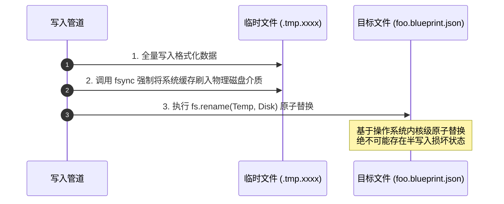

# 持久化机制与落盘契约规范

适配层（Adapters）是整个蓝图系统与物理磁盘直接交互的**唯一 I/O 边界**。

命令行工具、HTTP 路由处理器、模板实例化引擎以及历史快照归档，所有涉及磁盘读写的操作均严格汇聚于此。本层的核心工程目标是：**保障数据写入的绝对原子性、崩溃一致性（Crash Consistency）与高并发协同下的无锁流动性**。

---

## 物理存储目录拓扑



---

## 一、 单一写入管道（Single Write Pipeline）

为确保文档变更的确定性与数据血统可追溯，系统确立**唯一的写入管道收口函数**。任何绕过此管道直接调用底层 `fs.writeFile` 写盘的行为，均被视为严重架构违规：



```ts
// ❌ 严重违规：私自拼接 JSON 裸写磁盘，导致版本序列断流、历史快照缺失、校验旁路化
await fs.writeFile(filePath, JSON.stringify(documentData, null, 2), 'utf-8');

// ✅ 正确范式：统一经由受控的单一写入管道收口
await changeDocument(filePath, {
  ops: patchOperations,
  actor: 'cli',
  reason: 'Update screen layout and theme variables',
});
```

**单一管道承载的刚性职责**：
1. **原子前置校验**：确保在数据真正落盘前，所有领域不变量（ID 唯一性、无环树）100% 校验通过；
2. **状态版本自增**：严格递增版本号与更新时间戳，为前端提供可靠的轮询与缓存失效依据；
3. **快照归档**：在写入主文档的同时，异步在 `history/` 目录压入一份不可变增量快照，支持无损时光倒流；
4. **全异步非阻塞**：管道内所有文件 I/O 必须遵循纯异步契约，严禁同步调用卡顿事件循环。

---

## 二、 并发模型：无锁架构与最后写入者胜（Last-Write-Wins）

在人机协同场景下，人类工程师在前端拖拽调整布局与 AI 智能体在会话中批量更新文案，往往发生在同一微秒级时间窗口内。

### 1. 为什么坚决不采用加锁或版本拦截？
- **传统悲观锁的死穴**：一旦加文件排他锁，AI 生成过程若耗时数秒，人类用户的鼠标拖拽将被瞬间冻结，造成灾难性的交互阻断。
- **乐观锁（版本号匹配）的弊端**：若校验版本号，任何一方写入就会导致另一方收到“文档已被修改，请刷新重试”的错误，导致人类或 AI 的心流被频繁打断。

### 2. 细粒度节点合并策略
系统采用**按节点 ID 局部字段就地合并（Fine-grained Merge by Node ID）**，遵循**「最后写入者胜（LWW）」**原则：
- 若人类修改节点 A，AI 修改节点 B，两者互不干扰，合并后两者皆保留；
- 仅当两者在同一时刻修改了同一个节点内部的同一个属性时，以时间戳靠后者生效。我们在架构上完全接受此概率极低的覆盖代价，以换取零锁阻塞的高吞吐体验。

---

## 三、 崩溃一致性保障：原子落盘协议（Write-Rename Pattern）

任何操作系统在执行磁盘写入时，都存在进程崩溃、操作系统死机或异常断电的风险。若直接覆写目标文件，中途崩溃必然产生**截断的、残缺的半份损坏 JSON（Partial Write Corruption）**，导致工程彻底无法读取。

蓝图在底层通过标准的 **POSIX 临时文件原子重命名（Atomic Rename）**机制保障崩溃一致性：



无论任何时刻发生意外崩溃，磁盘上永远**要么是旧版完整的 JSON，要么是新版完整的 JSON**，绝不存在半死不活的损坏状态。

