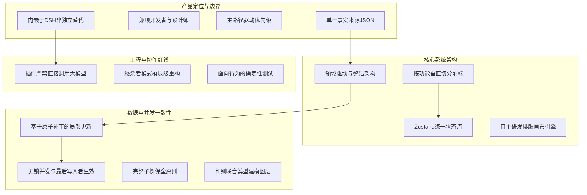

# 核心架构与技术决策记录 (ADR)

本文档系统收录了蓝图（Blueprint）项目在产品演进、系统架构、数据持久化与工程质量维度的核心设计决策。

每一项决策均代表了团队权衡利弊后确立的技术定论与不变量（Invariants）。任何后续的架构重构或功能迭代，均须以此处收录的决策为基准；若因业务发展需要推翻既有决策，必须经过严肃的技术评审并同步更新此文档。

---

## 决策全景架构

---

## 一、 产品定位与功能边界

### 1. 深度内嵌于 DSH 协作流，不做孤立的桌面端设计工具
- **【决策结论】** 蓝图作为内嵌扩展运行于 DeepSeek Harness 中，与对话工作区共享同一上下文生命周期。
- **【权衡考量】** 现代 AI 辅助研发的核心断点在于“上下文切换”。若将设计工具做成独立外置软件，用户就必须在聊天窗与设计软件之间频繁导入导出、反复切屏描述，打断工作心流。将画布与对话融合成同一份文档的双向视图，才能真正实现“边聊边看、边改边写”的无缝闭环。

### 2. 同时服务两类用户群体，以阶梯式能力覆盖不同深度
- **【决策结论】** 蓝图同时支撑“不精通设计的全栈开发者”与“追求精细落地的高级设计师”，不在这两类群体之间做排他性二选一。
- **【权衡考量】** 两者的诉求在本质上处于同一条演进路径上：前者需要 AI 交付 80 分开箱即用的高保真视觉结果；后者在此基础上需要像素级的 Flex 盒模型调优、组件复用与设计规范收敛。同一个数据底座通过不同操作界面满足深浅两层诉求，能最大限度发挥工具价值。

### 3. 严格遵循专业设计软件的交付标准，拒绝玩具级草图
- **【决策结论】** 产品功能与交互体验必须达到工业级设计工具标准（流畅拖拽、精准吸附、清晰缩放、完备撤销）。
- **【权衡考量】** 如果只是绘制粗糙的概念线框图，纯文本或手绘截图的生产效率远高于专门的可视化工具。蓝图只有在操作手感与视觉精度上达到专业标准，才能成为团队信赖的主力工作台，产出可直接交付工程落地的生产级界面。

### 4. 研发优先级完全由核心主路径驱动，杜绝盲目对标竞品功能表
- **【决策结论】** 所有需求的排期必须映射到 `happy-path.md`（核心主路径）的具体阶段，优先消除上游阻断性卡点。
- **【权衡考量】** 盲目照抄成熟商业软件（如 Figma）庞大的功能清单，不仅耗费巨量研发资源，还会造出一堆脱离当前实际场景的边缘功能。我们的唯一度量衡是：Design Engineer 在从“一个点子”走向“高保真原型”的过程中，究竟被卡在哪一步。

### 5. 功能边界采取分期演进策略，采用「暂缓」代替「永久否决」
- **【决策结论】** 暂时不服务于核心主路径的高级功能归入「暂缓清单」，不草率将其定性为“永远不做”。
- **【权衡考量】** 随着产品从简单的应用原型逐步深入到高复杂度 Web 应用，团队对设计能力的诉求会动态演进。使用“暂缓”保留了架构弹性，并在文档中写清当下暂缓的客观原因，为未来的场景演进留出推翻前提的空间。

### 6. 当前阶段的明确暂缓清单：矢量钢笔、布尔运算、图层蒙版、渐变网格
- **【决策结论】** 当前阶段坚决不开发复杂的矢量图形编辑与插画级布尔运算。
- **【权衡考量】** 上述功能属于重度插画师与矢量图形制作工具的专精领域，而蓝图的核心靶心是 UI/UX 布局组织、界面状态与代码交付。将有限的算力与工程资源聚焦在排版树与状态机上，才是投入产出比最高的选择。

### 7. 单一 JSON 文档承载全部设计资产，坚决不拆分多份文件
- **【决策结论】** 一个蓝图工程的所有屏幕、图层、状态分支、交互连线和设计变量，统一持久化为一份自包含的结构化 JSON。
- **【权衡考量】** 分布式或多文件存储必然带来分布式一致性维护的噩梦。一旦多份文件在网络中断、进程崩溃或并发写入时发生状态漂移，排查与修复成本极高。坚持“单一事实来源（Single Source of Truth）”，HTML、CSS 及组件树均实时从此派生。

### 8. 针对大文档设计分段按需读取机制，解耦文件体积与 AI 上下文开销
- **【决策结论】** 底层命令行与协议全面支持精准过滤（按屏幕筛选、按图层子树提取、按字段投影），严禁要求 AI 每次吞吐整份大文档。
- **【权衡考量】** 随着工程界面膨胀，单份 JSON 文件可能达到数兆字节。但大语言模型的调用成本与注意力只与“当前上下文输入量”相关。通过节点 ID 精确提取待修改子树，可以在保持单文档架构的同时，将 Token 消耗严格控制在最小范围。

---

## 二、 系统架构与技术选型

### 9. 数据层严格遵循领域驱动设计（DDD）与整洁架构分层
- **【决策结论】** 领域模型（Domain Model）位于系统最内核，对外层实现细节保持绝对零依赖；外层通过应用服务与接口适配器向内核单向依赖。
- **【权衡考量】** 领域模型是整个项目最核心的数字资产。一旦领域对象直接引用了 Node 文件系统、HTTP 路由或 React 组件，就意味着核心逻辑被特定运行环境绑定，不仅单元测试变得迟钝臃肿，未来迁移适配也会寸步难行。内核代码必须能够被直接复制到任何无依赖的空白项目中独立编译运行。

### 10. 界面层采用按功能垂直切分（Feature-first），不按技术横向分层
- **【决策结论】** 前端代码按业务功能独立成包（画布 canvas、图层树 layers、属性栏 inspector、蓝图库 library），每个功能包内聚合自身的组件、Hooks、Store 与工具函数。
- **【权衡考量】** 传统的横向分层（所有 hooks 堆在一起、所有 components 堆在一起）会导致代码物理结构割裂。修改一个简单的“拖拽手柄”功能，需要在五六个深层目录之间反复横跳。垂直功能切分保证了代码的高内聚、低耦合。

### 11. 单一代码仓库与双运行环境并存
- **【决策结论】** 服务端（Node.js 运行时）与浏览器端（Web / React 运行时）共存于同一代码包中，共用底层类型系统与协议定义。
- **【权衡考量】** 蓝图需要与宿主系统进行深度 IPC 交互，拆分成多个独立的 npm 包会极大增加本地调试与构建联调的复杂度，破坏共享 TypeScript 类型时的一致性保障。

### 12. 前端界面选型 React 18，严格对齐宿主平台技术栈
- **【决策结论】** 界面层无缝接入 React 18，不另立门户引入其他 UI 框架。
- **【权衡考量】** DSH 宿主环境的插件插槽、事件分发与组件渲染体系均基于 React。保持同构技术栈可以复用基础设施，避免任何跨框架通信带来的性能损耗与包装层维护成本。

### 13. 全局统一收敛至 Zustand 进行状态管理
- **【决策结论】** 客户端状态方案统一规范为 Zustand，严格禁止在主状态流中混用 Context、Redux 或全局模块变量。
- **【权衡考量】** 团队协作中最忌讳“状态百花齐放”，混用多种方案会导致新同学读代码时需要先猜测状态的同步机制。Zustand 足够精炼、对 Hooks 友好、支持天然的外部 Action 调度，完美契合我们复杂的对象图状态管理。

### 14. 状态归属按照「消费主体（谁读它）」切分，而非按数据结构拆分
- **【决策结论】** 仅有单个业务功能消费的状态严格限制在自身模块的 Store 内；跨模块消费的全局数据（如当前活动蓝图）才提升为共享 Store。
- **【权衡考量】** 若盲目将所有临时状态（如画框拖动坐标、输入框当前文本）塞入全局 Store，会导致每次指针移动或按键击发都触发大范围订阅者的无谓重渲染，引发严重的性能劣化。

### 15. 画布编辑器底层自主研发，拒绝套用臃肿的第三方开箱即用画布库
- **【决策结论】** 画布核心的盒模型计算、树形渲染与手势系统自主实现，仅在局部能力（如复杂拖拽算法、撤销栈机制）合理引入高内聚的轻量纯函数工具。
- **【权衡考量】** 市面上成熟的开源图编辑库（如基于图形拓扑的流程图库）通常建立在平铺绝对坐标系上，根本无法天然支撑 Web 界面极其严苛的弹性盒（Flexbox）、间距合并（Margin/Padding）与动态内容撑高逻辑。自己掌控核心渲染管线，是保障长期灵活扩展的前提。

### 16. 画布排版采用「自由摆放为主、弹性排布为辅」的并存架构
- **【决策结论】** 屏幕与图层默认采用自由坐标摆放；需要整齐排列时，由用户按需为容器启用 Flex 布局约束。
- **【权衡考量】** 纯绝对定位无法保证响应式与工程代码的高保真还原，而纯 Flex 布局又会扼杀初期原型发散时随手摆放的直觉体验。两者非对立关系，自由摆放提供创作自由度，Flex 布局提供工程约束度。

---

## 三、 数据持久化与变更一致性

### 17. 并发写入采用无锁机制，执行「最后写入者胜（Last-Write-Wins）」策略
- **【决策结论】** 底层写操作基于节点 ID 进行增量合并，不引入悲观锁拦截，不抛出“版本冲突，请重试”的错误。
- **【权衡考量】** 在人机协同模式下，人类用户拖动布局与 AI 智能体修改文案可能在同一秒内发生。强行加锁拦截会导致交互频繁受阻、体验极度破碎。在节点级别执行最后写入者生效，能以最低的通信复杂度支撑流畅的高并发协同。

### 18. 数据变更全面推行结构化补丁（JSON Patches），杜绝全量覆写
- **【决策结论】** 修改文档必须生成最小化的确定性操作集（Ops / Patches），严禁直接用内存中的全量对象整份重写磁盘文件。
- **【权衡考量】** 整份覆写不仅无法进行细粒度的局部撤销（Undo），还会彻底抹除并发协作者在同一时刻修改的其他节点数据，引发隐蔽的数据回滚与状态漂移。

### 19. 补丁操作必须具备「完整子树保全」能力
- **【决策结论】** 插入或移动容器节点时，操作载荷中必须完整包裹其包含的所有子节点树，严禁将子节点与父节点拆散提交。
- **【权衡考量】** 增量同步一旦剥离了子元素引用，回放时容器就会退化成空壳，导致下游数据永久丢失。操作必须在数据结构层面做到自包含。

### 20. 撤销/重做基于「用户操作事务（Actions）」，而非单次状态变更点
- **【决策结论】** 一次连续的鼠标拖拽微调、或一段连续的键盘打字输入，在底层必须打包为一个独立的撤销事务单元。
- **【权衡考量】** 如果每次 pointermove 发送的状态变更都被记录为一次撤销步长，用户按一次 Ctrl+Z 只能回退 1 像素的移动距离，撤销功能将彻底失去实用价值。

### 21. 资源删除执行「软归档至回收站」，禁止物理硬抹除
- **【决策结论】** 删除蓝图或模板时，数据统一移动到工作区的 `.dsh-blueprint/trash/` 隔离目录下，并附带时间戳标记。
- **【权衡考量】** 人类误触或 AI 误操作的发生概率不可忽视，数据一旦从磁盘扇区硬抹除就彻底不可逆。软归档兼顾了界面的清洁度与极端情况下的无损找回能力。

### 22. 节点 ID 作为永久唯一身份标凭，生命周期内保持稳定
- **【决策结论】** 节点 ID 具备全局唯一性。节点在被属性更新、或者在不同图层树层级之间移动时，其 ID 必须严格沿用，严禁随意销毁并重注新 ID。
- **【权衡考量】** 撤销栈的差异比对、状态分支的 Delta 追踪、协同通讯的寻址定位，全部建立在稳定的 ID 锚点上。ID 漂移将导致整个系统的引用关系彻底崩塌。

### 23. 图层采用判别联合类型（Discriminated Unions）进行显式建模
- **【决策结论】** 文本（TextLayer）、图标（IconLayer）、图形（ShapeLayer）等拥有各自独立的类型定义，通过 `kind` 字段进行类型收窄；坚决禁止用一个通用的超级对象装入所有可能的属性。
- **【权衡考量】** 扁平万能类型会导致代码充斥着大量可选字段（`fontSize?: number`、`iconSet?: string`）。编写代码时毫无类型提示保障，阅读代码时无法辨析属性有效性，新增图层时更会导致类型定义迅速腐化。

---

## 四、 职责边界与协作协议

### 24. 插件本体严禁直接调用大模型，严禁私自拼装提示词
- **【决策结论】** 插件代码库只负责数据存储、协议解析、画布渲染与编辑交互；所有 AI 生成能力必须收口至会话环境中的独立 Agent，通过标准命令行工具交互。
- **【权衡考量】** 这是系统的核心安全红线。一旦插件内部私自请求模型，就会导致双重决策、提示词黑盒散落、上下文失控且极难进行确定性自动化测试。职责清晰才能保障系统的可维护性。

---

## 五、 工程质量与交付纪律

### 25. 存量系统重构采用「逐模块绞杀替换（Strangler Pattern）」，禁止盲目推倒重来
- **【决策结论】** 识别出坏味道的代码时，按独立功能模块逐个重构替换，每换一个模块都必须完成类型校验与视觉回归比对。
- **【权衡考量】** “推倒重来”是工程领域最昂贵的幻觉，往往在重写过程中丢弃大量边缘业务处理。通过模块级的渐进式替换，既能平稳清除技术债务，又能确保线上业务丝毫不受中断。

### 26. 界面组件必须具备可访问性（a11y）并显式标注测试契约标识
- **【决策结论】** 可交互元素必须支持标准的键盘访问链路，关键交互节点必须显式标注结构化的 `data-testid` 属性。
- **【权衡考量】** 严禁依赖容易漂移的 CSS ClassName 或视觉文本作为端到端测试的选择器。结构化的测试属性能够为 Playwright 等自动化测试提供坚不可摧的定位锚点。

### 27. 测试用例只保护公开业务行为，绝不绑定具体实现细节
- **【决策结论】** 测试必须针对“输入特定操作后，系统是否产生预期的业务产物”进行断言；严禁对组件的私有内部状态、具体的颜色值或无意义的样式快照进行机械断言。
- **【权衡考量】** 绑定实现细节的测试极其脆弱，每次代码微调都会引发大面积测试报错（False Positives），最终沦为开发者的负担。测试保护的是业务契约的稳定性。

### 28. 恪守「先打扫屋子，再引入新功能」的代码纪律
- **【决策结论】** 在针对某一模块进行架构重构与债务清理期间，严禁夹带任何业务新特性的开发。
- **【权衡考量】** 将重构与新增需求混杂在同一个 Pull Request 里，是引入隐蔽 Bug 的最主要源头。一旦测试报错，很难定位是原有逻辑迁移失误，还是新需求本身的缺陷。

### 29. 坚持分层验证与门禁检查，禁止无序长跑
- **【决策结论】** 每一个架构层级或模块的改动提交前，必须在本地依次跑通：类型检查（`typecheck`）、单元测试（`test`）与国际化校验（`i18n:check`），全部绿灯方可推进。
- **【权衡考量】** 小步快跑、及时反馈。在早期发现类型或逻辑漏洞的成本极低，将问题堆积到最终集成阶段再去排查，返工成本将呈指数级放大。
