# 核心主路径：从原始想法到高保真可落地原型

这条主路径（Happy Path）定义了用户使用蓝图完成一次完整设计工作的标准生命周期。

它不仅是一份端到端的用户体验地图，更是我们**评估功能优先级、判定架构边界与验收标准的第一基准**：任何新需求或技术优化，首先要问它服务于这条主路径上的哪一个环节；不在主路径上的能力，一律暂缓投入。

---

## 主路径阶段演进图

```mermaid
flowchart LR
    S0["阶段 0：概念梳理与架构分解<br/>(Information Architecture)"]
    S1["阶段 1：首屏生成与具象呈现<br/>(Generative First-Pass UI)"]
    S2["阶段 2：直接操纵与精细微调<br/>(Direct Manipulation)"]
    S3["阶段 3：多屏串联与全局流程<br/>(Multi-screen Journey)"]
    S4["阶段 4：视图状态矩阵<br/>(View State Matrix)"]
    S5["阶段 5：交互语义与事件响应<br/>(Interaction Semantics)"]
    S6["阶段 6：动效预览与手感校准<br/>(Motion Dynamics)"]
    S7["阶段 7：资产规格交付与代码生成<br/>(Design-to-Code Handoff)"]

    S0 --> S1 --> S2 --> S3 --> S4 --> S5 --> S6 --> S7
```

---

## 阶段详解

### 阶段 0：概念梳理与信息架构分解（Information Architecture）
- **用户目标**：只有一个模糊的产品想法或业务痛点，尚未形成具体的页面构想。需要先梳理出“这个应用要解决什么问题、一共需要哪几个屏幕、页面之间大致如何流转”。
- **系统能力支撑**：AI 扮演产品顾问角色，从用户的一段自然语言描述中提炼出整体蓝图骨架：自动列出页面集合、各屏核心信息块、以及主业务走向。
- **当前现状**：暂未打通自动化链路，目前完全依赖用户先在脑海中想清楚具体的页面名称。
- **核心体验瓶颈**：这是整个体验漏斗的入口。没有前置的架构梳理，非设计专业的用户很难跨过从零到一的启动门槛。

---

### 阶段 1：首屏生成与具象呈现（Generative First-Pass UI）
- **用户目标**：迅速看到界面实际长什么样，告别抽象的文字描述。
- **系统能力支撑**：通过简短指令在数秒内生成单屏界面。生成的界面必须具备“成品感”：使用符合业务场景的真实文案（而非通篇 Lorem Ipsum 占位符）、合理的盒模型间距与协调的配色，杜绝纯灰块堆叠。
- **当前现状**：核心链路已跑通。通过工程内置的生成技能与底层命令行工具，已能稳定输出单屏原型。
- **核心体验瓶颈**：生成质量高度依赖模型对具体设计规范的理解深度。当缺乏对应领域的模板支撑时，结构容易偏向简单粗暴，需要多次提示词微调。

---

### 阶段 2：直接操纵与精细微调（Direct Manipulation）
- **用户目标**：对生成的界面做细节修整——改动不顺眼的文案、拉宽拥挤的边距、微调按钮尺寸、更换主色调，直接在画布上拖拽修改。
- **系统能力支撑**：
  - 画布基础能力：支持点选、多选、区域框选、拖拽移动、等比/自由缩放、画布平移；
  - 辅助定位系统：智能对齐参考线、像素级吸附（Snap）；
  - 组织与定位：层级树查看、拖拽重排、成组（Group）与解组；
  - 稳健的安全机制：可靠的多级撤销（Undo）与重做（Redo），保证任何误操作都能一键复原。
- **当前现状**：点选、框选、拖拽、缩放、属性面板编辑与基础撤销已完备；但吸附算法精度与对齐引导线较弱，缺少便捷的图层成组操作。
- **核心体验瓶颈**：如果画布拖动不顺手、对齐靠肉眼，用户在设计第二屏时就会丧失信心。直接操纵的手感是决定它“像不像专业设计工具”的最直接分水岭。

---

### 阶段 3：多屏串联与用户旅程（Multi-screen Journey & Prototyping）
- **用户目标**：设计不是单页艺术，而是一个完整流程。PM 需要把首页、列表页、详情页、支付页、成功结果页并排陈列在同一块画布上，串起端到端的用户体验闭环。
- **系统能力支撑**：
  - 画布容纳多屏幕并排排布与自由编组；
  - 元素级原型跳转绑定（点击商品卡片 $\rightarrow$ 跳转商品详情页）；
  - **绝不在画布上拉蜘蛛网连线**，而是通过选区属性与轻量指示标识交互目标；
  - 提供 Figma 同款的 **「原型播放 / 走查模式（Play Mode）」**，在真机预览窗中点击即可实际跳转。
- **当前现状**：已支持在同一画布上摆放多个屏幕；但原型交互绑定与播放走查模式尚未实现。
- **核心体验瓶颈**：缺乏原型交互串联时，画布上只散落着几个互不相干的静止画面，无法进行真正生动的交互走查和产品逻辑验收。

---

### 阶段 4：视图状态矩阵与增量差异（View State Matrix）
- **用户目标**：真实产品界面从来不是静态单一的。PM 必须事无巨细地定义和验证同一个页面在不同业务条件下的表现：
  - **默认态**（有正常数据）；
  - **空数据态**（首次使用、无内容提示与引导按钮）；
  - **加载中态**（骨架屏、Loading 动效）；
  - **异常态**（网络超时、报错重新加载）。
- **系统能力支撑**：单一屏幕支持附加多种状态视图；底层数据仅存储相对于默认状态的**增量补丁（Delta）**；界面上支持一键平滑切换预览，并支持通过交互动作（如 `change_state`）动态触发。
- **当前现状**：暂未支持。
- **核心体验瓶颈**：缺少状态矩阵支持时，PM 往往因绘图繁琐而漏画边缘状态，或者不得不手工克隆出四张几乎一样的屏幕；后续改动一个导航栏标题，就需要同步修改四遍。

---

### 阶段 5：交互因果与弹层覆盖（Interaction Semantics & Overlays）
- **用户目标**：验证现代 App 最核心的局部交互因果。比如：“点击筛选按钮从底部升起 ActionSheet”、“点击提交先切换为 Loading 状态，校验成功后关闭弹窗并跳转”。
- **系统能力支撑**：
  - 丰富的触发器（Triggers）：点击（On click）、悬停（While hovering）、定时延迟（After delay：用于启动页等待、Toast 定时关闭）；
  - 专业的动作响应（Actions）：打开弹层/抽屉（Open overlay：居中弹窗、底部抽屉）、关闭弹层（Close overlay）、状态切换（Change state）、返回（Back）；
  - 半透明遮罩（Backdrop）与外侧点击自动关闭（Click outside to close）。
- **当前现状**：暂未支持。
- **核心体验瓶颈**：没有 Overlays 和触发机制，弹窗和抽屉就只能画成悬空的一块普通卡片，完全无法还原真实的弹起和交互手感。

---

### 阶段 6：转场动效与手感校准（Transitions & Motion Dynamics）
- **用户目标**：感受交互细节的品质——底部抽屉拉起是否顺畅？页面推入（Push）的速度是否自然？Toast 渐出（Dissolve）的时机是否恰当？
- **系统能力支撑**：
  - 转场动效体系（Transitions）：瞬间切换（Instant）、淡入淡出（Dissolve）、滑入滑出（Slide in/out）、推入（Push）、智能补间（Smart Animate）；
  - 手感参数：缓动曲线（Ease out, Ease in-out）与持续时间（Duration，默认 300ms）；
  - 播放器中 100% 真实回放。
- **当前现状**：暂未支持。
- **核心体验瓶颈**：纯静态原型无法传递手感和节奏。缺失了转场动效，所谓的“高保真”就始终停留在视觉截图层面。

---

### 阶段 7：资产规格交付与代码生成（Design-to-Code Handoff）
- **用户目标**：设计闭环的终点——交给下游编码 Agent 全自动还原，或者由工程师接手迅速上线。
- **系统能力支撑**：导出信息无损、定义精确的单一结构化 JSON 契约。完整包含盒模型尺寸、排版约束、设计系统变量（Tokens）、状态差异、事件流转与动效时长，下游解析引擎拿来即可准确映射为前端代码。
- **当前现状**：底层已有结构化 JSON，但部分样式属性仍使用字面量直接定义（尚未完全收敛至 Token 引用），事件系统与动效参数也尚未并入正式规格。
- **核心体验瓶颈**：如果导出的规格需要二次猜测或大量人工修正，“所见即所得”的价值链就会在最后一步折损。

---

## 主路径的工程指导原则

1. **上游卡点未消，不盲目向下游冒进**：
   - 阶段 0 至阶段 3 是每次使用都必须经历的刚需主干。如果连对齐吸附都做不好，过早投入动效播放器只会造出中看不中用的玩具。
   - 优先级始终是：先让核心链路顺畅流动，再拓展边缘体验。
2. **拒绝架构孤岛，保持数据底座统一**：
   - 阶段 3 的「屏幕流转」与阶段 5 的「交互事件」，在数据模型本质上是统一的——屏幕跳转就是交互事件产生动作的一种特例。架构设计时必须统筹考虑，绝不建立两套互相割裂的数据结构。
3. **完成度的衡量标准是卡点消失**：
   - 判断一个功能是否算“做完”，唯一标准是看当前环节的用户瓶颈是否得到根本性解决，而不是功能参数是否堆砌得足够多。

---

## 关于竞品对标与功能取舍（以 Figma 为例）

Figma 是当前设计工具的行业标杆，其在渲染引擎和交互细腻度上经过了多年打磨，我们充分尊重其先进性，但必须根据我们的主路径坚持清晰的取舍逻辑：

- **差异化护城河（做 Figma 没有或做得不够顺畅的）**：
  屏幕多状态（States）、业务逻辑流转（Flows）、语义化事件系统（Events）、真实代码向的交付契约（Tokens）。这是将设计无缝连通到工程研发的必经之路，是我们的核心战场。
- **分期暂缓（不盲目追随其重型插画能力）**：
  复杂的钢笔矢量绘图、布尔运算、图层蒙版、网格渐变等，属于纯美术与插画向的垂直能力。它们不在当前 UI/UX 核心主路径上，我们将其统一放入**「暂缓清单」**中。暂缓并不代表永远否决，未来当业务向更丰富的美术资产拓展时，再适时引入即可。
