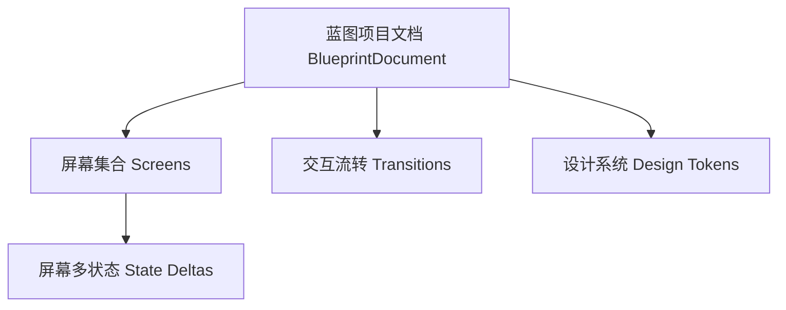

# 产品定位与设计规格

## 产品定义

蓝图（Blueprint）是内嵌在 DeepSeek Harness（DSH）内部的高保真**交互原型与设计工作台**。

它的核心心智模型是：**“让产品经理（PM）用自然语言驱动 AI，低成本产出具备 Figma 生产级质感、事无巨细（含全状态矩阵）、且带转场动画的高保真可交互原型（Play / Prototype）。”**

在过去，人类产品经理很难独自完成如此高标准的原型：手动绘制大量页面、配齐各种异常状态、在复杂原型工具里配置微观交互和动效，耗时极长。
有了蓝图，**用户出需求与逻辑（做 PM），AI 充当资深 UI/UX 设计师（做执行手）**。画布既是静态界面的检视面板，更是能真实点选走查、带转场手感的“真机播放器”。

---

## 核心痛点与存在价值

纯文本的自然语言在描述视觉界面和交互逻辑时，存在天然的**语义带宽瓶颈**：
- **描述成本高、易失真**：要用文字把页面层级、间距尺寸、组件配色甚至交互流转讲清楚，往往需要洋洋洒洒成百上千字，而 AI 生成的代码还经常与用户脑海里的构想偏差极大。
- **静态截图无法验证真实交互体验**：没有可运行的原型，团队只能看着静态图片脑补流程。真正上线后才发现弹层跳出突兀、空数据态没有设计、手感生硬。

**蓝图的核心使命：充当人类 PM 与真实产品之间的「高保真交互桥梁」：**
1. **一句话出全套高保真方案**：用户输入业务描述，AI 自动生成结构完整、文案真实、配色协调的成套屏幕。
2. **事无巨细的边缘状态自动覆盖**：AI 自动为页面推导并生成空数据态、加载骨架屏、异常报错态，无需 PM 逐字逐句催促补充。
3. **Figma 级的交互播放走查（Interactive Prototype）**：不仅是静态看图，点击按钮真的能触发转场动画（左滑推进、弹层升起、淡入淡出），在手机外壳中直接验证产品手感。
4. **无损对接工程实现**：最终落盘的是严谨结构化模型，下游编码 Agent 拿到的不再是模糊草图，而是包含布局、样式、多状态与交互因果的完整规格。

---

## 目标用户与使用场景

蓝图服务于两类核心人群。两者的使用深度不同，但共用同一套底层工作流：

### 1. 独立开发者与全栈工程师（追求快速出原型）
- **核心诉求**：无需深究复杂的设计理论与配色规范，希望快速得到一个视觉水准在 80 分以上的现代界面。
- **体验目标**：AI 自动填充符合业务场景的真实文案、标准的排版间距与和谐的配色体系，用户无需从空白草稿纸画起，把精力完全集中在业务功能与逻辑表达上。

### 2. 具备设计经验的工程师与产品设计师（追求精准落地）
- **核心诉求**：需要像素级的精确控制力、严格统一的设计规范（Design Tokens）以及完整的状态流转定义。
- **体验目标**：支持图层层级整理、自动布局（Flexbox）约束和复用能力。在画布上改完之后，产物能直接转化为机器可读的结构化规格，彻底告别“画完原型还要人肉向开发解释一遍设计细节”的割裂现状。

---

## 质量与完成度标准

**蓝图遵循专业设计软件的交付标准，而不是随意涂鸦的简易草稿本。**

如果只是画粗糙的线框图，纯文字或白板截图往往更快。蓝图之所以存在，是因为它提供了一整套工业级的操作基础：
- 拖拽平滑、缩放无损、图层定位清晰；
- 支持精准的吸附与对齐辅助线；
- 属性编辑细致明确，支持完整的撤销与重做保障。

它必须是一个让人能真正坐下来完成高保真设计工作的主工作台，而不是玩具性质的概念预览。

---

## 领域模型核心要素

一个完整的蓝图项目在逻辑上由三大部分构成：

### 1. 屏幕（Screen）与图层树（Layer Tree）
- **屏幕**是画布上的独立可视矩形区域，代表应用里的一个具体页面或视图。
- 屏幕内部通过**树状结构的图层（Layer Tree）**组织，遵循标准的 Web 盒模型规范，包含容器、文本、图形、图标等不同种类的专业图层节点。

### 2. 屏幕多状态（Screen States）
同一个界面在真实运行环境中会有不同的状态，例如：**默认展示态**、**空数据态**、**加载中**、**网络异常态**等。
- 蓝图采用**增量差异（Delta Patch）**的设计理念：只记录各个状态相对于基准状态的变化量，绝不在底层克隆多份完整屏幕，避免“改一处文案需要同步修改四张图”的数据膨胀与一致性问题。

### 3. 原型交互与转场动效（Interactions & Transitions）
- **绝非蓝图节点连线（No Spiderweb Wires）**：蓝图不把画布做成充满杂乱连线的节点图，而是严格对齐 **Figma 原型交互模型（Trigger -> Action -> Transition）**。
- **触发器（Triggers）**：点击（On click）、悬停（While hovering）、定时延迟（After delay：用于 Splash 启动屏、Toast 3秒自动消失、骨架屏倒计时）。
- **动作响应（Actions）**：页面跳转（Navigate to）、弹出浮层（Open overlay：底部抽屉、居中弹窗）、关闭浮层（Close overlay）、切换视图状态（Change state）。
- **转场动效（Transitions）**：推入（Push）、滑入滑出（Slide in/out）、淡入淡出（Dissolve）、智能补间（Smart Animate）以及可调缓动曲线（Easing/Duration）。
- **原型播放器（Presentation / Play Mode）**：支持一键进入真机预览走查模式，点选元素执行真实转场动画，点击空白处自动闪烁蓝色高亮提示可点击交互热区。

### 4. 设计系统（Design Tokens）
- 将颜色、字阶、字重、间距、圆角等设计规范集中定义在同一命名空间下。
- 画布中所有图层均引用对应的 Token 标识。未来只要在设计系统中微调全局色板，整套蓝图的所有界面将全自动同步响应。

---

## 画布布局理念：自由摆放与弹性排版共存

在界面的排版布局上，蓝图不走极端，兼顾灵感创作的自由与工程落地的严谨：

- **基础能力：自由摆放（Absolute Positioning）**
  图层默认使用绝对坐标自由拖动，想放在哪里就拖到哪里。这是人类在头脑风暴和视觉探索时最自然、最没有心智负担的方式。
- **进阶能力：弹性排版（Flexbox Auto-layout）**
  当需要精确对齐和自适应内容时，可以为屏幕或容器容器一键开启 Flex 弹性排布。设置行/列方向、子项间距（Gap）、内边距（Padding）与对齐规则后，子元素交由排版引擎自动计算位置，不再杂乱飘移。

---

## 产物与交付模式：单一度量来源（Single Source of Truth）

### 1. 单一完整的结构化数据文档
蓝图的全部设计成果均持久化为一份统一的结构化 JSON 文档，装载了图层层级、尺寸、位置约束、样式变量、交互事件与多状态。

**坚持不拆分成多份文件**：拆分越多，文件之间的同步成本越高，一致性被破坏是软件系统最隐蔽的 Bug 来源。HTML 代码、CSS 样式、React 组件树均作为下游从这份权威数据中无损实时派生。

### 2. 针对 AI 上下文的分段按需读取（Selective Slicing）
虽然整份设计文档可能随着屏幕增多而变得庞大，但 AI 并不需要、也不应该在每次交互时全量读入。

蓝图在底层协议上深度支持**精准分段查询**：
- 支持仅列出屏幕摘要；
- 支持按屏幕 ID 仅读取当前屏幕的子树；
- 支持按图层 ID 读取特定节点属性。

在调用大模型时，上下文消耗只取决于「本次修改命中了哪一部分数据」，与「整个工程文件有多大」彻底解耦。
