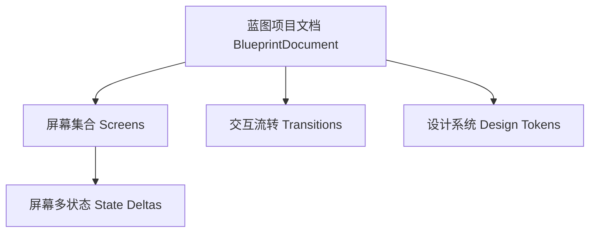

# 产品定位与设计规格

## 产品定义

蓝图（Blueprint）是内嵌在 DeepSeek Harness（DSH）内部的可视化界面设计工作台。

它把专业设计工具的核心能力无缝带入了 AI 对话工作流中：**画布（Canvas）与对话窗口（Chat）本质上是同一份文档在不同维度的呈现**。人类工程师与 AI 智能体可以同时在一个共享的界面模型上协作推演、共同修改。

---

## 核心痛点与存在价值

纯文本的自然语言在描述视觉界面时，存在天然的**语义带宽瓶颈**：
- **描述成本高、易失真**：要用文字把页面层级、间距尺寸、组件配色甚至交互流转讲清楚，往往需要洋洋洒洒成百上千字，而 AI 生成的代码还经常与用户脑海里的构想偏差极大。
- **缺乏所见即所得的反馈循环**：在没有画布的情况下，用户必须等待代码编译运行才能看到效果，改一个小间距都需要重新走一遍提问、写代码、预览的全过程。

**蓝图的核心使命就是充当人类与 AI 之间的「视觉沟通桥梁」：**
用户只需一句日常的大白话（例如：“帮我做个记账 App，首页展示本月总支出、最近三笔账单，底部带四个标签栏”），画布上就能立刻呈现出一整屏结构完整、文案真实、配色协调的高保真界面。

用户可以直接在画布上拖拽微调，AI 也能感知到画布上的所有修改。最终落盘的是一份定义严谨的结构化模型，下游的编码 Agent 拿到后可以直接生成生产级前端代码，无需二次猜测。

---

## 目标用户与使用场景

蓝图服务于两类核心人群。两者的使用深度不同，但共用同一套底层工作流：

### 1. 独立开发者与全栈工程师（追求快速出原型）
- **核心诉求**：无需深究复杂的设计理论与配色规范，希望快速得到一个视觉水准在 80 分以上的现代界面。
- **体验目标**：AI 自动填充符合业务场景的真实文案、标准的排版间距与和谐的配色体系，用户无需从空白草稿纸画起，把精力完全集中在业务功能与逻辑表达上。

### 2. 具备设计经验的工程师与产品设计师（追求精准落地）
- **核心诉求**：需要像素级的精确控制力、严格统一的设计规范（Design Tokens）以及完整的状态流转定义。
- **体验目标**：支持图层层级整理、自动布局（Flexbox）约束和复用能力。在画布上改完之后，产物能直接转化为机器可读的结构化规格，彻底告别“画完原型还要人肉向开发解释一遍设计细节”的割裂现状。

---

## 质量与完成度标准

**蓝图遵循专业设计软件的交付标准，而不是随意涂鸦的简易草稿本。**

如果只是画粗糙的线框图，纯文字或白板截图往往更快。蓝图之所以存在，是因为它提供了一整套工业级的操作基础：
- 拖拽平滑、缩放无损、图层定位清晰；
- 支持精准的吸附与对齐辅助线；
- 属性编辑细致明确，支持完整的撤销与重做保障。

它必须是一个让人能真正坐下来完成高保真设计工作的主工作台，而不是玩具性质的概念预览。

---

## 领域模型核心要素

一个完整的蓝图项目在逻辑上由三大部分构成：

### 1. 屏幕（Screen）与图层树（Layer Tree）
- **屏幕**是画布上的独立可视矩形区域，代表应用里的一个具体页面或视图。
- 屏幕内部通过**树状结构的图层（Layer Tree）**组织，遵循标准的 Web 盒模型规范，包含容器、文本、图形、图标等不同种类的专业图层节点。

### 2. 屏幕多状态（Screen States）
同一个界面在真实运行环境中会有不同的状态，例如：**默认展示态**、**空数据态**、**加载中**、**网络异常态**等。
- 蓝图采用**增量差异（Delta Patch）**的设计理念：只记录各个状态相对于基准状态的变化量，绝不在底层克隆多份完整屏幕，避免“改一处文案需要同步修改四张图”的数据膨胀与一致性问题。

### 3. 交互流转（Transitions）
- 界面之间不是孤立的静态切片，而是有因果联系的动态流程（如：点击提交按钮跳转至成功页、接口报错弹出 Toast 提示）。
- 流转不仅是画布上直观可视的引导连线，其底层也是严谨的状态机事件数据。

### 4. 设计系统（Design Tokens）
- 将颜色、字阶、字重、间距、圆角等设计规范集中定义在同一命名空间下。
- 画布中所有图层均引用对应的 Token 标识。未来只要在设计系统中微调全局色板，整套蓝图的所有界面将全自动同步响应。

---

## 画布布局理念：自由摆放与弹性排版共存

在界面的排版布局上，蓝图不走极端，兼顾灵感创作的自由与工程落地的严谨：

- **基础能力：自由摆放（Absolute Positioning）**
  图层默认使用绝对坐标自由拖动，想放在哪里就拖到哪里。这是人类在头脑风暴和视觉探索时最自然、最没有心智负担的方式。
- **进阶能力：弹性排版（Flexbox Auto-layout）**
  当需要精确对齐和自适应内容时，可以为屏幕或容器容器一键开启 Flex 弹性排布。设置行/列方向、子项间距（Gap）、内边距（Padding）与对齐规则后，子元素交由排版引擎自动计算位置，不再杂乱飘移。

---

## 产物与交付模式：单一度量来源（Single Source of Truth）

### 1. 单一完整的结构化数据文档
蓝图的全部设计成果均持久化为一份统一的结构化 JSON 文档，装载了图层层级、尺寸、位置约束、样式变量、交互事件与多状态。

**坚持不拆分成多份文件**：拆分越多，文件之间的同步成本越高，一致性被破坏是软件系统最隐蔽的 Bug 来源。HTML 代码、CSS 样式、React 组件树均作为下游从这份权威数据中无损实时派生。

### 2. 针对 AI 上下文的分段按需读取（Selective Slicing）
虽然整份设计文档可能随着屏幕增多而变得庞大，但 AI 并不需要、也不应该在每次交互时全量读入。

蓝图在底层协议上深度支持**精准分段查询**：
- 支持仅列出屏幕摘要；
- 支持按屏幕 ID 仅读取当前屏幕的子树；
- 支持按图层 ID 读取特定节点属性。

在调用大模型时，上下文消耗只取决于「本次修改命中了哪一部分数据」，与「整个工程文件有多大」彻底解耦。
